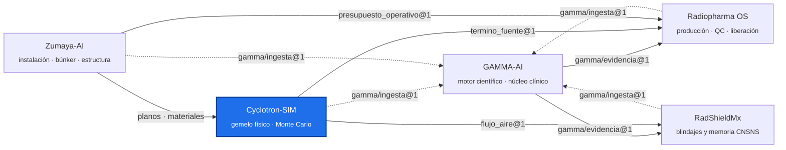

<!-- encabezado-gamma -->
<div align="center">

# Cyclotron-SIM

**Gemelo físico de ciclotrones médicos: CAD, haz, vacío, FEM y Monte Carlo de la bóveda**

   

[Qué aporta](#qué-aporta) · [Capacidades](#capacidades) · [Monte Carlo de la bóveda (F90)](#monte-carlo-de-la-bóveda-f90) · [Sustento científico](#sustento-científico) · [Integración con el ecosistema](#integración-con-el-ecosistema) · [Ecosistema GAMMA](#ecosistema-gamma)

</div>

> [!IMPORTANT]
> Repositorio privado, de uso individual del titular. Los documentos fuente son propiedad del titular, que tiene los derechos de uso.
<!-- /encabezado-gamma -->

Cyclotron-SIM es el gemelo físico de ciclotrones médicos, independiente del fabricante: geometría
paramétrica, haz y extracción, vacío, análisis estructural, magnético y de radiofrecuencia por
elemento finito, y Monte Carlo del término fuente y de la bóveda.

## Qué aporta

- **Física validada contra el fabricante.** El Monte Carlo de la bóveda del IBA KIUBE se compara con
  la Site Requirement Guide (Tabla 9): el cociente fabricante/MC queda entre 1.2 y 1.9.
- **Cada cota con su fuente.** Los parámetros de cada máquina llevan su documento o se marcan como
  estimados o pendientes de fuente (`machines/_schema/maquina.schema.yaml`).
- **Datos para las demás plataformas sin acoplar código.** El término fuente y el flujo de neutrones
  salen como contratos JSON versionados.

## Capacidades

| Dominio | Herramienta | Salida |
|---|---|---|
| Geometría | Python paramétrico → GDML (Geant4) y DAGMC | Modelos de máquina y bóveda |
| Monte Carlo | Geant4 11.4.3, QGSP_BIC_HP, muestreo por importancia | Dosis por cara del búnker, flujo térmico en el aire |
| Vacío | Molflow+ (TPMC) | Presión y stripping de gas |
| Haz | Órbita central y extracción | Parámetros del haz por puerto |
| Elemento finito | Estructural, magnético y RF | Esfuerzos, campo y modos |
| Visualización | Render e impresión 3D | Figuras y modelos físicos |

| Máquina | Estado |
|---|---|
| IBA Cyclone KIUBE 18 MeV (100–300 µA, doble haz) | Modelo completo; Monte Carlo F90 de la bóveda en curso |
| GE PETtrace, Best, ABT BG-75, LBT | Estructura lista; pendientes de fuentes |

## Monte Carlo de la bóveda (F90)

Doble haz de 2 × 150 µA con el rendimiento IBA de 6.9 × 10⁻³ n/p y sin puertas blindadas en los
puertos. 69 de 88 lotes completos al 02-11-2026. Espesores interinos de tabique TD-250: este 2.08 m,
oeste 1.95 m, sur 1.82 m, techo 1.95 m (convergido). Flujo térmico en el aire a 300 µA: media
4.9 × 10⁶ n/cm²/s.

Los lotes restantes tardan más porque el mapa de importancia tiene saltos muy grandes entre celdas
vecinas; la siguiente campaña usará un mapa gradual (cociente ≤ 4) y puntos de control por lote.

## Sustento científico

| Fuente | Uso |
|---|---|
| IBA Cyclone KIUBE SRG (MID 55672 Rev G) y propuesta técnica | Geometría, término fuente y validación |
| Geant4 (Agostinelli et al., 2003; Allison et al., 2016), datos G4NDL | Transporte de neutrones y fotones |
| IAEA SRS-47 | Marco de blindaje de ciclotrones |
| Molflow+ (CERN) | Vacío por Monte Carlo de partículas de prueba |

## Integración con el ecosistema

| Archivo | Contrato | Consumidor |
|---|---|---|
| `machines/iba_kiube/export/termino_fuente.json` | `cyclotron-sim/termino_fuente@1` | Radiopharma OS |
| `machines/iba_kiube/export/flujo_aire_boveda.json` | `cyclotron-sim/flujo_aire@1` | RadShieldMx |
| `gamma-ingesta.json` | `gamma/ingesta@1` | GAMMA-AI |

Diferencia con los demás repositorios: aquí se **simula** la física. Zumaya-AI aporta el edificio,
RadShieldMx el cálculo analítico y la memoria, y Radiopharma OS la operación.

## Contenedor de cómputo

| Imagen | Contenido |
|---|---|
| `cyclotron-sim-mc` (`hpc/Dockerfile`) | Geant4 11.4.3 con datos HP, Python 3.12 y el benchmark de la bóveda compilado con `-O3` |

```powershell
docker build -t cyclotron-sim-mc -f hpc/Dockerfile .
docker run -d --name mc_f90 --cpus 22 -v "${PWD}\salida:/salida" cyclotron-sim-mc todas 22 200 22
```

Cada lote es un proceso independiente con su semilla; los lotes terminados se saltan al relanzar.
Geant4 transporta en CPU: acelera el número de núcleos, no la GPU. Con 22 lotes el contenedor usa
unos 23 GB de memoria.

## Uso

```bash
cd machines/iba_kiube
python -m pytest
python build.py --lod mc
python mc_benchmark/analizar_f90.py <salida>
```

## Colaboraciones

Abierto a colaboradores invitados: físicos de aceleradores y de Monte Carlo (Geant4, OpenMC, FLUKA)
e ingenieros de vacío y radiofrecuencia. Los datos del fabricante se comparten sólo bajo
confidencialidad.

## Hoja de ruta

1. Cerrar el MC F90 y actualizar los contratos.
2. Variante con TD-250 bajo en hidrógeno cuando llegue su composición.
3. Simuladores con la misma infraestructura para linac, PET/CT, HDR y Gamma Knife.

## Ecosistema GAMMA

Cinco repositorios privados unidos por contratos JSON versionados, no por imports. Este repositorio
está resaltado.



## Confidencialidad y licencia

Software propietario de uso individual del titular; no es de código abierto ni se distribuye.
Los documentos fuente son propiedad del titular, que tiene los derechos de uso. Ningún dato de
pacientes reales entra a este repositorio: los datos clínicos permanecen anonimizados y fuera de
GitHub. Las salidas técnicas no sustituyen la revisión ni la firma del profesional responsable.
