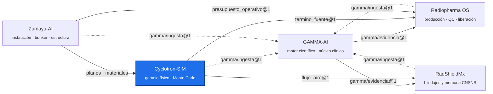

<!-- encabezado-gamma -->
<div align="center">

# Cyclotron-SIM

**Gemelo físico de ciclotrones médicos: CAD, haz, vacío, FEM y Monte Carlo de la bóveda**

   

[Objetivos](#objetivos) · [Máquinas](#máquinas) · [Contratos exportados](#contratos-exportados) · [Contenedor de cómputo Monte Carlo](#contenedor-de-cómputo-monte-carlo) · [MC de la bóveda (F89 → F90)](#mc-de-la-bóveda-f89--f90) · [Ecosistema GAMMA](#ecosistema-gamma)

</div>

> [!IMPORTANT]
> Repositorio privado, de uso interno. Los documentos fuente son propiedad del usuario, que tiene los derechos de uso.
<!-- /encabezado-gamma -->

Modelos CAD y físicos de ciclotrones médicos, independientes del fabricante:
- geometría paramétrica;
- haz y extracción;
- vacío (Molflow+);
- FEM estructural, magnético y de RF;
- Monte Carlo (Geant4/OpenMC) del término fuente y de la bóveda.

Es la parte física de B.20 (Digital Twin) del plan canónico de GAMMA, y la fuente de datos del
ciclotrón para Radiopharma OS, RadShieldMx y Zumaya-AI.

## Objetivos

1. **Modelo trazable de cada máquina.** Cada cota lleva su fuente (`DS`, SRG, paper) o se marca
   como `EST` o `pendiente_fuente` (`machines/_schema/maquina.schema.yaml`).
2. **Término fuente y dosis validados contra el fabricante.** El MC de la bóveda del KIUBE se
   compara con la SRG Rev G de IBA.
3. **Exportar contratos JSON** para las demás plataformas, sin que tengan que importar código.

## Máquinas

| Carpeta | Máquina | Estado |
|---|---|---|
| `machines/iba_kiube` | IBA Cyclone® KIUBE 18 MeV (100–300 µA, doble haz, puertos VE 13–17 MeV) | Modelo v0.36; gemelo físico (antes F63–F85 de RPOS); MC de la bóveda F90 en curso |
| `machines/ge_pettrace` | GE PETtrace | Pendiente de fuentes |
| `machines/best_cyclotron_systems` | Best Cyclotron Systems | Pendiente de fuentes |
| `machines/abt_bg75` | ABT BG-75 | Pendiente de fuentes |
| `machines/lbt_longevous` | Longevous Beam Technologies | Pendiente de fuentes |

```
machines/iba_kiube/
  params.yaml, materials.yaml   parámetros con fuente
  build.py, render*.py          GDML/DAGMC, renders
  mc_benchmark/                 Geant4 bunker_iba (C++), lectura y análisis F90
  resultados/mc_f90/            configuraciones del MC
  gemelo_fisico/                stripping de gas, vacío TPMC, órbita central, data/kiube, tools
  export/                       contratos JSON (ver abajo)
  fuentes/                      SRG, propuesta IBA y papers → indexados en GAMMA
hpc/                            imagen Docker de cómputo MC y lanzador paralelo
herramientas/manifiesto_gamma.py   manifiesto gamma/ingesta@1 de las fuentes
rpos_fases/                     parches históricos F81–F85 (referencia)
```

## Contratos exportados

| Archivo | Contrato | Consumidor |
|---|---|---|
| `machines/iba_kiube/export/termino_fuente.json` | `cyclotron-sim/termino_fuente@1` | Radiopharma OS (plan de producción) |
| `machines/iba_kiube/export/flujo_aire_boveda.json` | `cyclotron-sim/flujo_aire@1` | RadShieldMx (ventilación Ar-41) |
| `gamma-ingesta.json` | `gamma/ingesta@1` (24 fuentes) | GAMMA-AI (corpus científico) |

## Contenedor de cómputo Monte Carlo

| Imagen | Base | Contenido |
|---|---|---|
| `cyclotron-sim-mc` (`hpc/Dockerfile`) | `mambaorg/micromamba:1.5.10` | Geant4 **11.4.3** con física QGSP_BIC_HP y datos HP, Python 3.12, `bunker_iba` compilado con `-O3` |

```powershell
docker build -t cyclotron-sim-mc -f hpc/Dockerfile .
docker run -d --name mc_f90 --cpus 22 -v "${PWD}\salida:/salida" cyclotron-sim-mc todas 22 200 22
```

- Cada lote es un proceso de un solo hilo con su semilla. Se puede detener y relanzar
  (`docker start mc_f90`): los lotes con `*_regiones.txt` ya escritos se saltan.
- **La GPU no ayuda**, porque Geant4 transporta en CPU. Lo que acelera es el número de núcleos.
- **Memoria:** con 22 lotes en paralelo el contenedor usa unos 23 GB. En una VM de Docker de
  31 GB no hay que correr al mismo tiempo otro contenedor pesado sin tope de memoria: el
  01-11-2026 la VM se quedó sin memoria y detuvo el MC.
- Detalle en `hpc/README.md`.

## MC de la bóveda (F89 → F90)

- **F89** incluía las puertas blindadas opcionales de IBA en T1/T5 y subestimaba la dosis
  exterior unas 10 veces frente a la SRG.
- **F90** las quita (no se van a comprar) y usa doble haz de 2 × 150 µA con el rendimiento IBA de
  6.9 × 10⁻³ n/p.
- **Estado al 02-11-2026:** 69 de 88 lotes (este 16, oeste 15, sur 16, techo 22). Los 19
  restantes corren en paralelo desde el reinicio por falta de memoria del 01-11; su duración
  varía de 3 a más de 10 h porque el mapa de importancia tiene saltos de 10¹¹–10¹³ entre celdas
  vecinas (Geant4 recomienda un cociente entre 0.25 y 4) y el splitting se dispara.
  - Comparación con la tabla 9 de la SRG: el cociente IBA/MC queda entre 1.2 y 1.9.
  - Espesores TD-250 interinos: este 2.08 m, oeste 1.95 m, sur 1.82 m y techo 1.95 m (techo
    convergido).
  - Flujo térmico en el aire a 300 µA: media 4.9 × 10⁶ n/cm²/s y p95 9.2 × 10⁶ n/cm²/s
    (`flujo_aire_f90.py`).
- Análisis: `mc_benchmark/analizar_f90.py`. Cuando terminen los 88 lotes se actualizan el informe
  y los contratos.

## Uso rápido (KIUBE)

```bash
cd machines/iba_kiube
python -m pytest                 # modelo y gemelo físico
python build.py --lod mc         # GDML Geant4 + DAGMC
mc_benchmark/compilar.sh         # benchmarks Geant4 en local
python mc_benchmark/analizar_f90.py <salida>
```

Más salidas (neutrónica, FEM estructural y magnético, vacío, impresión, render) en
`machines/iba_kiube/README.md`.

## Relación con otros repos

- **GAMMA-AI:** motor científico. Indexa `fuentes/` (SRG, propuesta IBA, papers) y responde con
  citas verificables.
- **Radiopharma OS:** planea la producción contra `termino_fuente@1`.
- **Zumaya-AI:** proyecto de la instalación (búnker, blindajes y estructura). Toma de aquí el
  modelo y el MC.
- **RadShieldMx:** cálculo analítico de blindajes y ventilación; usa `flujo_aire@1` y debe
  validarse contra estos MC.

## Pendientes

- Terminar el MC F90 (19 lotes) y correr la variante TD-250 bajo en hidrógeno.
- Suavizar el mapa de importancia (cociente ≤ 4 entre celdas vecinas) y agregar puntos de
  control por lote antes de la siguiente campaña.
- Documentos IBA por integrar: reporte de blindaje MC, plano de puertos con blancos asignados y
  datos de las puertas blindadas. Van en `machines/iba_kiube/fuentes/` y se citan en `params.yaml`.

## Ecosistema GAMMA

Cinco repositorios privados unidos por contratos JSON versionados, no por imports. Este repositorio
está resaltado.



## Confidencialidad y licencia

Software propietario de uso individual del titular; no es de código abierto ni se distribuye.
Los documentos fuente son propiedad del titular, que tiene los derechos de uso. Ningún dato de
pacientes reales entra a este repositorio: los datos clínicos permanecen anonimizados y fuera de
GitHub. Las salidas técnicas no sustituyen la revisión ni la firma del profesional responsable.
